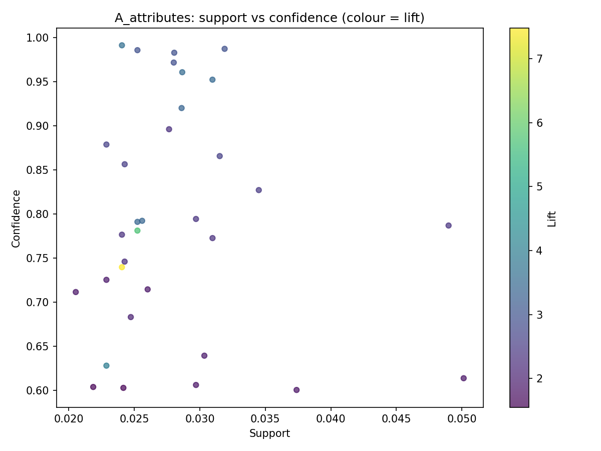
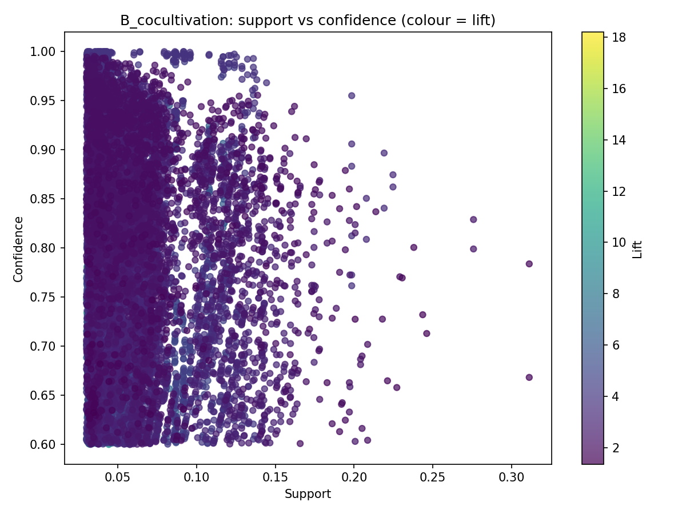

# Discovering Crop Patterns and Co-Cultivation Relationships in Agriculture Using Association Rule Mining

A Predictive Analytics course project that applies **association rule mining (FP-Growth)** to district-level crop production records from India (1997 to 2015). The project discovers which crops belong to which season, which crops are grown together, and which crops are linked with high or low yield, and expresses these findings as simple if-then rules.

> Symbiosis Institute of Technology, Nagpur | B.Tech Computer Science and Engineering (Batch 2023-27) | Semester 6

---

## Table of Contents

- [Problem Statement](#problem-statement)
- [Dataset](#dataset)
- [Approach](#approach)
- [Key Results](#key-results)
- [Project Structure](#project-structure)
- [Installation](#installation)
- [Usage](#usage)
- [Output Files](#output-files)
- [Configuration](#configuration)
- [Limitations](#limitations)
- [Future Work](#future-work)
- [Author](#author)

---

## Problem Statement

Indian agriculture generates large volumes of district-level crop records, but they are mostly used for totals and trend charts. This project asks:

1. Which crops are normally grown in which season?
2. Which crops are commonly cultivated together in the same district and season?
3. Which crops are associated with high or low yield levels?

The answers are given as interpretable rules ranked by **support**, **confidence** and **lift**.

---

## Dataset

**Crop Production in India** (`crop_production.csv`), available on Kaggle:
https://www.kaggle.com/datasets/abhinand05/crop-production-in-india

| Property | Value |
|---|---|
| Records | 246,091 (242,361 after cleaning) |
| Attributes | `State_Name`, `District_Name`, `Crop_Year`, `Season`, `Crop`, `Area`, `Production` |
| States / UTs | 33 |
| Districts | 646 |
| Crops | 124 |
| Seasons | Kharif, Rabi, Whole Year, Summer, Winter, Autumn |
| Years | 1997 to 2015 |

> The dataset file is not included in this repository. Download it from the link above and place it in the project folder.

---

## Approach

```
Data Preprocessing -> Transaction Creation -> Frequent Itemset Mining (FP-Growth)
-> Rule Generation -> Rule Filtering (Confidence and Lift)
-> Visualization and Interpretation -> Saving Results
```

**Preprocessing**
- Trim padded spaces in text columns (for example `"Kharif     "`)
- Drop 3,730 records with missing `Production`
- Create `Yield = Production / Area`
- Bin `Area` and `Yield` into Low, Medium and High (equal-sized groups)
- Leave `Production` out of the items because it is redundant with `Area`

**Two analyses**

| | Analysis A: Attribute rules | Analysis B: Co-cultivation rules |
|---|---|---|
| Transaction | One record | One basket: state + district + year + season |
| Items | State, season, crop, area group, yield group | Crops grown in the basket |
| Transactions used | 242,361 | 29,175 baskets with 2+ crops |
| Distinct items | 169 | 124 |
| Example rule | `Crop=Wheat -> Season=Rabi` | `Arecanut -> Coconut` |

**Rule-quality measures**
- **Support**: share of transactions that contain the itemset
- **Confidence**: `Support(A and B) / Support(A)`
- **Lift**: `Confidence(A -> B) / Support(B)`; above 1 means a positive association

---

## Key Results

| Statistic | Analysis A | Analysis B |
|---|---|---|
| Frequent itemsets | 180 | 3,658 |
| Rules (after filtering) | 33 | 12,569 |
| Median confidence | 0.787 | 0.801 |
| Median lift | 2.48 | 3.35 |
| Highest lift | 7.48 | 18.20 |

**Selected rules**

| Rule | Confidence | Lift |
|---|---|---|
| Wheat -> Season = Rabi | 0.953 | 3.49 |
| Gram -> Season = Rabi | 0.961 | 3.52 |
| Arhar/Tur -> Season = Kharif | 0.896 | 2.30 |
| Sugarcane -> Season = Whole Year | 0.793 | 3.42 |
| Rapeseed and Mustard -> Wheat | 0.875 | 3.36 |
| Urad -> Moong | 0.829 | 2.40 |
| Arecanut -> Coconut | 0.814 | 12.40 |
| Khesari -> Masoor | 0.985 | 6.92 |
| Masoor, Moong -> Peas and beans, Urad | 0.749 | 18.20 |

**Main findings**
- Crops follow clear seasonal patterns: wheat, gram and mustard are Rabi crops, arhar/tur is a Kharif crop, and sugarcane is a Whole Year crop.
- Maize and Rice are the most widely grown pair, found together in 31.1% of baskets.
- Distinct crop clusters appear: a Kharif staple and pulse mix, a Rabi mix of wheat, gram and mustard, pulse groups, and a plantation group (arecanut, coconut, banana, tapioca, turmeric).

### Support vs Confidence (colour = lift)

| Analysis A | Analysis B |
|---|---|
|  |  |

---

## Project Structure

```
.
├── crop_association_rules.py      # Main script (both analyses)
├── crop_production.csv            # Dataset (download separately)
├── association_results/           # Generated results
│   ├── A_attributes_frequent_itemsets.csv
│   ├── A_attributes_rules.csv
│   ├── A_attributes_rules_plot.png
│   ├── B_cocultivation_frequent_itemsets.csv
│   ├── B_cocultivation_rules.csv
│   └── B_cocultivation_rules_plot.png
├── requirements.txt
└── README.md
```

---

## Installation

Requires Python 3.8 or later.

```bash
git clone https://github.com/<your-username>/<your-repo-name>.git
cd <your-repo-name>
pip install -r requirements.txt
```

`requirements.txt`:

```
pandas
mlxtend
matplotlib
```

---

## Usage

1. Download `crop_production.csv` from Kaggle and place it next to the script.
2. Run:

```bash
python crop_association_rules.py
```

The script prints the top rules of each analysis and saves everything to the `association_results/` folder.

**Google Colab:** upload `crop_production.csv`, then set `CSV_PATH = "/content/crop_production.csv"` at the top of the script before running it. Download the results from the Files panel afterwards.

---

## Output Files

| File | Content |
|---|---|
| `A_attributes_frequent_itemsets.csv` | Frequent itemsets of Analysis A with support and length |
| `A_attributes_rules.csv` | Rules of Analysis A sorted by lift |
| `A_attributes_rules_plot.png` | Support vs confidence scatter plot, coloured by lift |
| `B_cocultivation_frequent_itemsets.csv` | Frequent itemsets of Analysis B |
| `B_cocultivation_rules.csv` | Rules of Analysis B sorted by lift |
| `B_cocultivation_rules_plot.png` | Support vs confidence scatter plot, coloured by lift |

---

## Configuration

Edit the settings at the top of `crop_association_rules.py`:

| Parameter | Analysis A | Analysis B |
|---|---|---|
| `MIN_SUPPORT` | 0.02 | 0.03 |
| `MIN_CONFIDENCE` | 0.60 | 0.60 |
| `MIN_LIFT` | 1.2 | 1.2 |
| `MAX_LEN` | 4 | 4 |

In the script these appear as `A_MIN_SUPPORT`, `B_MIN_SUPPORT` and so on. Lowering the support threshold adds rules about rarer crops; raising the lift or confidence threshold reduces the many overlapping rules in Analysis B.

---

## Limitations

- Association rules show co-occurrence, not cause and effect.
- Production is recorded in crop-specific units and yield groups are computed across all crops together, so yield-based rules partly reflect unit differences.
- The minimum support threshold removes rare crops.
- Analysis B produces many overlapping rules because each itemset can be split in several ways.
- 2015 is only partially covered and the time dimension is not modelled.
- No weather, soil or price data is used, and no state-level rules passed the thresholds in Analysis A.

---

## Future Work

- Mine rules separately for each state or agro-climatic region
- Normalise yield within each crop before binning
- Combine with rainfall, temperature and soil datasets
- Prune redundant rules and use leverage and conviction
- Add a time dimension to study changing crop combinations
- Build a simple tool that suggests companion crops for a selected crop and season

---

## Author

**Mukund Kuthe**
B.Tech Computer Science and Engineering, Symbiosis Institute of Technology, Nagpur
Course: Predictive Analytics
